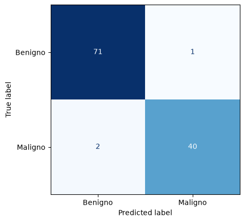
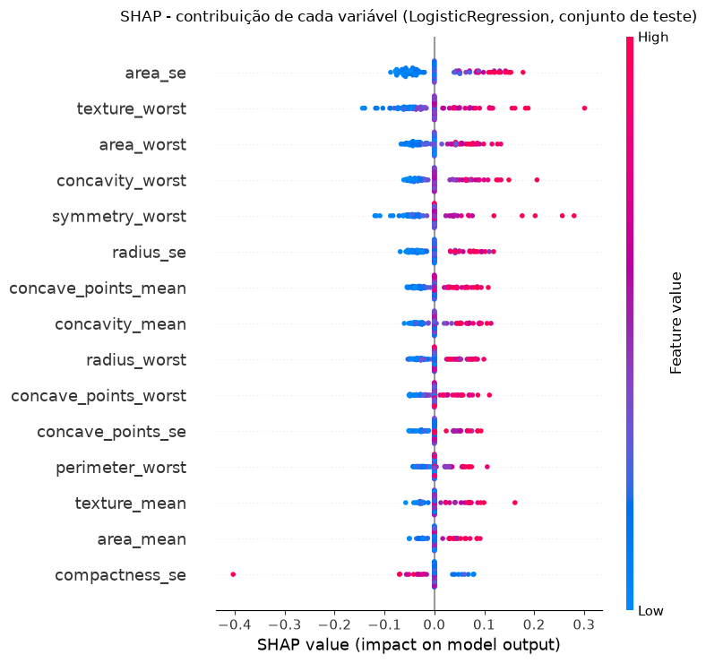
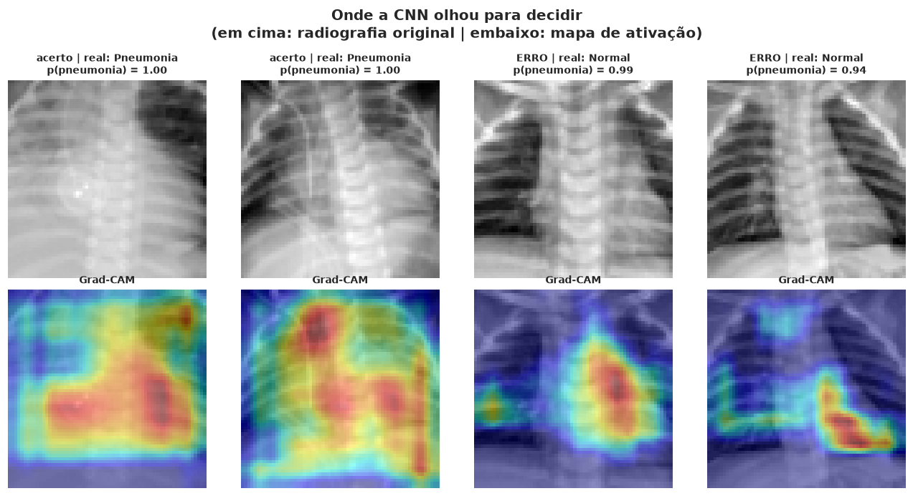

# Tech Challenge Fase 1

Base de um sistema de apoio ao diagnóstico para um hospital universitário. A tarefa principal classifica tumores de mama como **benignos ou malignos** a partir de medidas de exames de punção aspirativa por agulha fina (PAAF). Como entrega extra, uma **CNN** detecta pneumonia em radiografias de tórax.

O modelo é uma ferramenta de **apoio à triagem**: ele prioriza os exames na fila do especialista, mas o médico sempre tem a palavra final no diagnóstico.

- **Relatório técnico:** [`docs/relatorio_tecnico.pdf`](docs/relatorio_tecnico.pdf) (fonte em [`docs/relatorio_tecnico.md`](docs/relatorio_tecnico.md))
- **Vídeo de demonstração:** _(link a adicionar)_

## Resumo dos resultados

### Câncer de mama — Regressão Logística

O critério de escolha foi o **recall da classe maligna**, porque um falso negativo (câncer classificado como benigno) é o erro mais grave. Seis modelos (Dummy, KNN, SVM, Regressão Logística, Árvore de Decisão e Random Forest) foram comparados com `GridSearchCV` e validação cruzada estratificada de 5 folds no conjunto de treino. A Regressão Logística (`C = 1`, `class_weight = 'balanced'`, com `RobustScaler`) empatou com o SVM no recall e foi escolhida pela AUC mais alta e estável, pelas probabilidades nativas e pela interpretabilidade.

O limiar de decisão de **0,35** minimiza o custo esperado `10 × FN + FP` (com a regra de 1 erro-padrão) e foi escolhido apenas com validação cruzada repetida no treino.

| Métrica (teste, 114 exames, limiar 0,35) | Valor |
|---|---|
| Recall (sensibilidade) | **0,952** (40 de 42 malignos; IC 95%: 0,84–0,99) |
| Precisão | 0,976 |
| Especificidade | 0,986 |
| Acurácia | 0,974 |
| F1-score (maligno) | 0,964 |
| ROC AUC | 0,997 |

Na validação cruzada (20 repetições, 170 malignos), o mesmo limiar tem sensibilidade de 0,973 e especificidade de 0,962.

<p align="center">
  
  
</p>

As variáveis que mais pesam na decisão (coeficientes, SHAP e permutation importance) estão ligadas ao tamanho, à irregularidade e à heterogeneidade dos núcleos celulares, como `texture_worst`, `area_se`, `symmetry_worst` e `concavity_worst`.

### EXTRA — Pneumonia em radiografias com CNN

CNN compacta (cerca de 295 mil parâmetros) treinada do zero no PneumoniaMNIST (64×64). O limiar clínico foi escolhido na validação para garantir sensibilidade mínima de 98%.

| Limiar (teste, 624 imagens) | Recall | Especificidade | Precisão | F1 | ROC AUC |
|---|---|---|---|---|---|
| Padrão (0,50) | 0,962 | 0,876 | 0,928 | 0,945 | 0,970 |
| **Clínico (0,0665)** | **0,990** | 0,688 | 0,841 | 0,909 | 0,970 |

<p align="center">
  
</p>

A discussão completa dos resultados, das limitações e do uso prático está no [relatório técnico](docs/relatorio_tecnico.pdf).

## Estrutura do projeto

```text
data/raw/          base original (Breast Cancer Wisconsin)
data/processed/    base tratada usada na modelagem
notebooks/         01 inspeção, 02 limpeza, 03 modelagem, 04 CNN (extra)
src/               treinar_modelo.py e prever_exemplo.py
models/metrics/    métricas registradas dos modelos
docs/              relatório técnico e figuras
```

## Dados

O projeto usa o dataset **Breast Cancer Wisconsin (Diagnostic)**, com 569 exames de punção aspirativa por agulha fina classificados como tumor maligno ou benigno.

- Fonte primária: [UCI Machine Learning Repository](https://archive.ics.uci.edu/dataset/17/breast+cancer+wisconsin+diagnostic), licença CC BY 4.0.
- Cópia utilizada: [Kaggle (uciml/breast-cancer-wisconsin-data)](https://www.kaggle.com/datasets/uciml/breast-cancer-wisconsin-data), salva em `data/raw/breast_cancer_wisconsin.csv`.
- Referência: Street, W. N., Wolberg, W. H., Mangasarian, O. L. (1993). _Nuclear feature extraction for breast tumor diagnosis_.

A inspeção inicial da base (incluindo a análise de correlação com o diagnóstico) está em `notebooks/01_data_inspection.ipynb`. A limpeza está em `notebooks/02_data_cleaning.ipynb` e gera a base tratada em `data/processed/breast_cancer_wisconsin_clean.csv`.

## Treinando e demonstrando o modelo

O modelo final e suas métricas estão documentados em `notebooks/03_modelagem.ipynb` e `models/metrics/metricas_validacao.json`. Para gerar o artefato do modelo sem executar o notebook:

```bash
uv run python src/treinar_modelo.py
```

O script reproduz a divisão estratificada de treino e teste registrada nas métricas e salva o pipeline completo em `models/tuned/logisticregression_tuned.joblib`. Em seguida, demonstre previsões com dois perfis fictícios e com 50 exames reservados no conjunto de teste:

```bash
uv run python src/prever_exemplo.py
```

Os perfis fictícios são sintetizados a partir das medianas por classe calculadas somente no conjunto de treino e não incluem rótulos reais. Para os 50 exames reservados, a saída mostra `y_verdadeiro`, `y_previsto`, probabilidade de malignidade, acerto por exame e a porcentagem de acerto total. Esses exames não participam do treinamento do modelo. As previsões são ilustrativas e não constituem diagnóstico médico. O artefato em `models/tuned/` é local e ignorado pelo Git, portanto execute primeiro o script de treinamento em cada ambiente.

## Setup do ambiente de trabalho

Este projeto usa Python e bibliotecas de ciência de dados e machine learning. O ambiente pode ser configurado de duas formas: com uv (recomendado) ou com pip tradicional.

### Opção recomendada: uv

O `uv` é um gerenciador de ambientes e dependências mais moderno e rápido. Para quem está começando, a instalação é simples:

link da documentação do UV: https://docs.astral.sh/uv/

#### Linux/macOS

```bash
curl -LsSf https://astral.sh/uv/install.sh | sh
```

Depois, reinicie o terminal ou execute:

```bash
source $HOME/.local/bin/env
```

#### Windows (PowerShell)

```powershell
powershell -ExecutionPolicy ByPass -c "irm https://astral.sh/uv/install.ps1 | iex"
```

#### Verificar instalação

```bash
uv --version
```

No diretório do projeto:

```bash
uv sync
source .venv/bin/activate
```

No Windows, use:

```powershell
uv sync
.\.venv\Scripts\Activate.ps1
```

Se o ambiente ainda não existir, o comando acima cria o ambiente virtual e instala as dependências definidas em `pyproject.toml`.

#### Comandos úteis do uv

Adicionar uma nova dependência ao projeto:

```bash
uv add nome-do-pacote
```

Adicionar uma dependência apenas para desenvolvimento:

```bash
uv add --dev nome-do-pacote
```

Atualizar todas as dependências do projeto:

```bash
uv lock --upgrade
```

Sincronizar o ambiente com o arquivo de lock:

```bash
uv sync
```

Ver todas as dependências instaladas no ambiente atual:

```bash
uv pip list
```

### Opção alternativa: pip

```bash
python -m venv .venv
source .venv/bin/activate
pip install -U pip
pip install -e .
```

> O comando `pip install -e .` usa o arquivo `pyproject.toml` como fonte das dependências principais do projeto.

**Recomendo fortemente usar o UV porque ele é muito mais rapido!**

## Criando notebooks

A pasta `notebooks/` do projeto é o local destinado para exploração de dados, treinamento e validação de modelos, comparação de experimentos, análise de métricas e registro de resultados.

### No VS Code

1. Abra a pasta do projeto no VS Code.
2. Crie os notebooks dentro de `notebooks/`.
3. No prompt de seleção de kernel, escolha o Python do ambiente virtual criado acima (`.venv`).
4. Use arquivos `.ipynb` para explorar dados, preparar features, treinar modelos, validar desempenho, comparar experimentos e registrar resultados.

### No navegador

Com o ambiente ativado, execute:

```bash
jupyter lab
```

ou

```bash
jupyter notebook
```

Isso abre o Jupyter no navegador e permite criar e executar notebooks diretamente no projeto.

## Se o notebook for criado primeiro no Colab

Quando o trabalho começar no Google Colab, instale primeiro as dependências do projeto:

```python
!pip install -U pip
!pip install joblib jupyterlab matplotlib numpy pandas scikit-learn scipy seaborn shap
```

Se for necessário trabalhar no entregável extra de visão computacional, também instale as dependências opcionais:

```python
!pip install -r requirements-extra.txt
```

Depois disso, o notebook pode ser exportado para o repositório com a extensão `.ipynb` e você continua editando ele localmente no VS Code ou no Jupyter.

## Dependências extras para visão computacional

O arquivo `requirements-extra.txt` deve ser usado somente para a tarefa extra de visão computacional / CNN. Ele não faz parte do ambiente principal do projeto e deve ser instalado apenas quando essa etapa for necessária.

Uso:

```bash
pip install -r requirements-extra.txt
```

ou, com uv:

```bash
uv pip install -r requirements-extra.txt
```

> Mantém o ambiente principal limpo e separa as dependências opcionais da etapa extra.

## EXTRA — visão computacional (CNN para pneumonia)

O entregável extra está em `notebooks/04_cnn_pneumonia.ipynb`: uma CNN treinada no **PneumoniaMNIST** (versão curada da base [Chest X-Ray Pneumonia](https://www.kaggle.com/datasets/paultimothymooney/chest-xray-pneumonia)) para detectar pneumonia em radiografias de tórax, com calibração do limiar clínico e interpretabilidade via Grad-CAM.

Antes de executar, instale as dependências extras na raiz do projeto:

```bash
uv pip install -r requirements-extra.txt
```

O dataset é baixado automaticamente para `data/medmnist/` na primeira execução (não versionado). O modelo treinado é salvo em `models/cnn_pneumonia.pt` e as métricas em `models/metrics/cnn_pneumonia_teste.json`.

## Guia de contribuição

Para quem está começando no Git, consulte o guia completo em [docs/guia-contribuicao-git.md](docs/guia-contribuicao-git.md).
