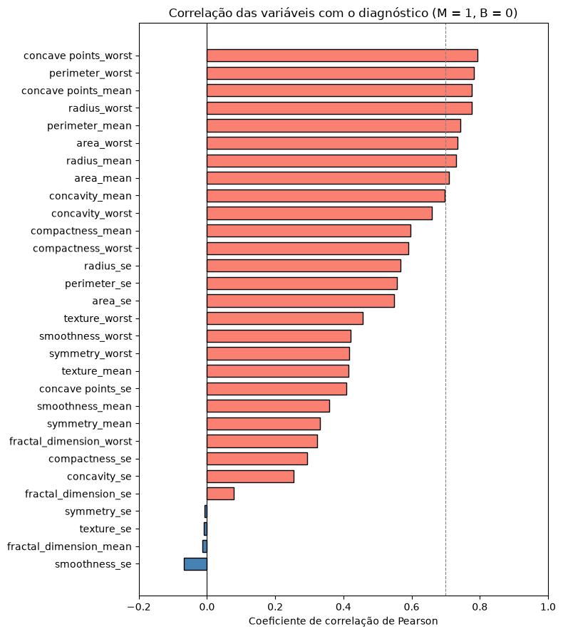
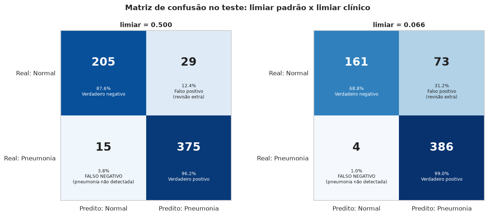

# Links do projeto

- **Repositório Git:** <https://github.com/vinicius-marques1/postech-tech-challenge-fase1>
- **Dataset principal (tabular) — Breast Cancer Wisconsin (Diagnostic):** <https://www.kaggle.com/datasets/uciml/breast-cancer-wisconsin-data> (fonte primária: [UCI Machine Learning Repository](https://archive.ics.uci.edu/dataset/17/breast+cancer+wisconsin+diagnostic))
- **Dataset extra (imagens) — Chest X-Ray Pneumonia:** <https://www.kaggle.com/datasets/paultimothymooney/chest-xray-pneumonia> (usado na versão curada PneumoniaMNIST, da coleção MedMNIST v2)
- **Vídeo de demonstração:** o link está disponível no `README.md` do repositório.

# 1. Contexto e objetivo

Um hospital universitário precisa acelerar a triagem de um volume crescente de exames sem abrir mão da segurança do paciente. Nesta primeira fase, o objetivo foi construir a base de um sistema de IA capaz de analisar resultados de exames automaticamente e **destacar os casos que merecem atenção prioritária** da equipe médica.

A tarefa principal é um problema de **classificação binária com dados tabulares**: a partir de medidas de núcleos celulares extraídas de exames de punção aspirativa por agulha fina (PAAF), estimar se um tumor de mama é **benigno (0)** ou **maligno (1)**. Como entrega extra, treinamos uma **rede neural convolucional (CNN)** que detecta pneumonia em radiografias de tórax.

Desde o início definimos qual erro é mais grave. Um **falso negativo** (tumor maligno classificado como benigno) pode atrasar o tratamento de um câncer. Já um **falso positivo** gera, no máximo, um exame adicional. Por isso, todas as decisões de modelagem foram guiadas pelo **recall (sensibilidade) da classe maligna**, com precisão e F1-score como contrapeso para que o modelo não vire um alarme permanente.

# 2. Dados

## 2.1 Breast Cancer Wisconsin (Diagnostic)

A base foi criada na Universidade de Wisconsin (Street, Wolberg e Mangasarian, 1993) a partir de imagens digitalizadas de PAAF de massas mamárias. Para cada exame foram medidas **10 características dos núcleos celulares** — raio, textura, perímetro, área, suavidade, compacidade, concavidade, pontos côncavos, simetria e dimensão fractal — em três versões:

- `_mean`: média da característica entre os núcleos do exame;
- `_se`: erro padrão, que indica o quanto os núcleos variam entre si;
- `_worst`: média dos três maiores valores, que captura os núcleos mais anormais.

| Característica da base | Valor |
|---|---|
| Exames | 569 |
| Variáveis preditoras | 30 numéricas (10 características × 3 versões) |
| Benignos / malignos | 357 (62,7%) / 212 (37,3%) |
| Arquivo original | `data/raw/breast_cancer_wisconsin.csv` |
| Arquivo tratado | `data/processed/breast_cancer_wisconsin_clean.csv` |

## 2.2 PneumoniaMNIST (entrega extra)

Versão padronizada da base Chest X-Ray Pneumonia (Kermany et al., 2018), com **5.856 radiografias pediátricas** em tons de cinza, rotuladas como normal ou pneumonia. Usamos a resolução de 64×64 pixels e a divisão oficial dos autores: 4.708 imagens de treino, 524 de validação e 624 de teste. O download é automático e não exige credenciais do Kaggle.

# 3. Análise exploratória

Notebook `notebooks/01_data_inspection.ipynb`. A exploração serviu para entender a base e decidir o que o pré-processamento precisaria resolver.

**Qualidade dos dados.** Não há valores ausentes nas variáveis de medida, nem registros duplicados (com ou sem a coluna `id`), nem valores negativos. Verificamos também a consistência geométrica: a área medida fica entre 0,92 e 1,06 vezes a área de um círculo com o raio medido, como se espera de núcleos aproximadamente circulares. O único problema estrutural é a coluna `Unnamed: 32`, 100% vazia, gerada por uma vírgula sobrando no cabeçalho do CSV.

**Distribuição das classes.** O desbalanceamento é moderado (62,7% benignos). Ele não impede a modelagem, mas exige divisão estratificada dos dados e mostra que a acurácia sozinha engana: um modelo que sempre responde "benigno" já acerta 63% dos casos.

**Escalas e assimetria.** As variáveis têm escalas muito diferentes: `area_worst` chega a 4.254, enquanto suavidade e dimensão fractal ficam abaixo de 1. Além disso, 22 das 30 variáveis têm assimetria acima de 1, todas com cauda à direita. O caso mais extremo é `area_se` (assimetria de 5,4; média de 40 contra mediana de 24,5). Modelos sensíveis à escala, como KNN, SVM e regressão logística, precisam de padronização.

**Outliers.** Pelo critério do intervalo interquartil (IQR), 29 das 30 variáveis têm valores extremos e **171 exames (30%)** apresentam pelo menos um. Desses, **114 são malignos e 57 benignos**. Em `area_worst`, por exemplo, nenhum tumor benigno ultrapassa o limite superior do IQR, enquanto 16,5% dos malignos ficam acima dele. Ou seja, os extremos não são erro de medição: são a própria manifestação da doença.

**Correlação com o diagnóstico.** Oito variáveis têm correlação acima de 0,7 com o diagnóstico, todas ligadas ao tamanho do núcleo (raio, perímetro e área) e a irregularidades do contorno (concavidade e pontos côncavos). A maior é `concave_points_worst` (0,79). No outro extremo, cinco variáveis têm correlação praticamente nula (|r| < 0,1), como `fractal_dimension_mean` e `texture_se`.

{width=58%}

**Multicolinearidade.** Há **21 pares de variáveis com |r| > 0,9**. Raio, perímetro e área são praticamente a mesma medida (r entre 0,98 e 1,00), já que perímetro e área são funções do raio. As versões `_mean` e `_worst` de uma mesma característica também são redundantes. Isso afeta principalmente a interpretação de modelos lineares e foi tratado na etapa seguinte.

# 4. Estratégias de pré-processamento

## 4.1 Limpeza

Notebook `notebooks/02_data_cleaning.ipynb`. A limpeza foi mínima e apenas estrutural; nenhum valor de medida foi alterado ou imputado.

| Item | Situação encontrada | Tratamento |
|--------------------|----------------------------|------------------------------------|
| `Unnamed: 32` | Coluna 100% vazia | Removida |
| `id` | Identificador único, sem valor preditivo | Removido (evita que o modelo "decore" exames) |
| `concave points_*` | Espaço no nome da coluna | Renomeado para `concave_points_*` |
| `diagnosis` | Texto (M/B) | Convertido para 1 (maligno) e 0 (benigno) |
| Valores ausentes e duplicatas | Nenhum | Verificado, sem alteração |
| Zeros em concavidade | 13 exames | Mantidos (núcleo sem reentrâncias é fisicamente possível) |
| Outliers | 171 exames, 2/3 malignos | Mantidos (ver 4.2) |

A base tratada tem 569 linhas e 31 colunas (30 preditoras e o alvo). O notebook termina com verificações automáticas (`assert`) do formato, dos tipos e da ausência de nulos, e relê o arquivo salvo para garantir que ele é idêntico ao que está em memória.

## 4.2 Decisão sobre os outliers

Em vez de remover os outliers por regra, testamos a hipótese diretamente. Com validação cruzada de 5 folds **apenas no conjunto de treino**, treinamos o mesmo modelo de duas formas: com todos os exames e sem os outliers (calculando os limites do IQR só com a parte de treino de cada fold). A avaliação foi sempre feita sobre a parte de validação completa, como seriam os exames reais.

| Cenário | Recall médio | Desvio entre folds |
|---|---|---|
| Com todos os exames | **0,947** | ± 0,034 |
| Sem os outliers | 0,847 | ± 0,104 |

A remoção descartava cerca de 107 exames por fold, dos quais 72 malignos — mais da metade dos malignos disponíveis. O recall caiu e o modelo ficou três vezes mais instável.

> **Decisão:** manter todos os exames e tratar a assimetria com escalonamento robusto, em vez de excluir registros.

## 4.3 Escalonamento e pipeline

Cada modelo foi montado como um `Pipeline` do scikit-learn com duas etapas: um escalonador seguido do classificador. Testamos três escalonadores:

- **StandardScaler:** subtrai a média e divide pelo desvio padrão;
- **MinMaxScaler:** leva cada variável para o intervalo de 0 a 1;
- **RobustScaler:** subtrai a mediana e divide pelo IQR, o que o torna pouco sensível a valores extremos.

Em vez de escolher o escalonador "no argumento", ele entrou como **mais um hiperparâmetro na busca em grade**. O resultado mostrou que a escolha importa para alguns modelos: o **RobustScaler** foi o melhor para a regressão logística e o MinMaxScaler para o KNN, enquanto os três empataram no SVM. Modelos de árvore não precisam de escalonamento.

Colocar o escalonador dentro do pipeline tem uma vantagem importante: ele é reajustado em cada fold usando só os dados de treino daquele fold. Assim, **nenhuma estatística do conjunto de validação ou de teste vaza para o treinamento**. O pipeline completo também é salvo em disco, então a inferência recebe dados brutos e aplica exatamente a mesma transformação.

## 4.4 Tratamento da redundância entre variáveis

O **VIF** (fator de inflação da variância) confirmou a multicolinearidade: `perimeter_mean` tem VIF de 4.110, quando valores acima de 10 já indicam problema. Testamos duas soluções, sempre dentro do pipeline e por validação cruzada:

- **PCA (transformar):** 10 componentes explicam 95% da variância. Com 10 ou mais componentes o recall da regressão logística e do SVM fica igual ao das 30 variáveis originais; com menos, todos os modelos pioram. Além de não ajudar, o PCA troca medidas clínicas por combinações abstratas que o médico não consegue interpretar.
- **Seleção de variáveis (remover):** mantendo, de cada grupo correlacionado acima de 0,9, a variável mais ligada ao diagnóstico, ficamos com 16 variáveis e o VIF máximo caiu de 4.110 para 27. Porém o recall da regressão logística caiu de 0,965 para 0,953.

> **Decisão:** usar as 30 variáveis originais. Nenhuma das alternativas melhorou o recall, e a interpretabilidade foi obtida de outra forma (coeficientes e SHAP, na seção 6).

## 4.5 Divisão dos dados

A base foi dividida de forma **estratificada em 80% treino (455 exames) e 20% teste (114 exames)**, com `random_state=42`, preservando a proporção de benignos e malignos nos dois conjuntos. Toda escolha de modelo, hiperparâmetro, escalonador e limiar foi feita por **validação cruzada estratificada de 5 folds dentro do treino**, que faz o papel do conjunto de validação. O conjunto de teste foi usado **uma única vez**, na avaliação final, para que o resultado reportado seja uma estimativa honesta do desempenho em dados novos.

# 5. Modelos usados e por quê

Notebook `notebooks/03_modelagem.ipynb`.

## 5.1 Modelos comparados

Começamos com modelos com hiperparâmetros escolhidos à mão para ter uma primeira leitura e depois refizemos a comparação de forma sistemática com `GridSearchCV`, otimizando o recall (`refit='recall'`). Cada técnica foi escolhida por representar uma abordagem diferente:

| Modelo | Como funciona | Por que foi testado |
|-------------|------------------------------|-----------------------------------|
| Dummy | Responde sempre a classe mais comum | Piso de referência: mostra quanto vale "não aprender nada" |
| KNN | Classifica pelo voto dos vizinhos mais próximos | Simples e não paramétrico; testa se exames parecidos têm o mesmo diagnóstico |
| SVM | Busca a fronteira com maior margem entre as classes (com kernel linear ou RBF) | Costuma ir muito bem em bases pequenas com muitas variáveis numéricas |
| Regressão Logística | Combina as variáveis linearmente e produz uma probabilidade | Interpretável por construção (um coeficiente por variável) e com probabilidades nativas |
| Árvore de Decisão | Aprende regras de corte em sequência | Modelo de regras, fácil de explicar; não precisa de escalonamento |
| Random Forest | Média de muitas árvores treinadas em amostras diferentes | Reduz o sobreajuste da árvore única e capta relações não lineares |

As grades incluíram, por exemplo, o número de vizinhos e a distância no KNN, `C`, `gamma` e o kernel no SVM, `C` e o balanceamento de classes na regressão logística, e profundidade e tamanho mínimo das folhas nas árvores.

## 5.2 Resultados da validação cruzada

Média e desvio dos 5 folds no conjunto de treino, já com os melhores hiperparâmetros de cada modelo:

| Modelo | Acurácia | **Recall (critério)** | F1 | ROC AUC |
|---|---|---|---|---|
| SVM (RBF, C = 10) | 0,976 ± 0,008 | **0,965 ± 0,029** | 0,967 | 0,994 ± 0,006 |
| **Regressão Logística** | 0,971 ± 0,011 | **0,965 ± 0,022** | 0,962 | **0,995 ± 0,004** |
| KNN (k = 3) | 0,980 ± 0,013 | 0,953 ± 0,030 | 0,973 | 0,984 ± 0,010 |
| Random Forest | 0,960 ± 0,020 | 0,947 ± 0,043 | 0,947 | 0,988 ± 0,007 |
| Árvore de Decisão | 0,945 ± 0,020 | 0,935 ± 0,043 | 0,927 | 0,957 ± 0,016 |
| Dummy | 0,626 | 0,000 | 0,000 | 0,500 |

**Por que não o KNN, que tem a maior acurácia?** Porque ele fica em terceiro no recall, que é o nosso critério, e esse é um bom exemplo de por que a métrica precisa ser escolhida antes da comparação. Há também um motivo técnico: com k = 3, o KNN só consegue produzir quatro probabilidades distintas (0, 1/3, 2/3 e 1), o que inviabiliza o ajuste fino do limiar de decisão.

## 5.3 Modelo escolhido: Regressão Logística

A regressão logística (`C = 1`, `class_weight = 'balanced'`, com RobustScaler) empatou com o SVM no recall, e a diferença entre os dois está dentro da margem de ruído. O desempate foi feito por critérios que importam num sistema de apoio ao diagnóstico, todos favoráveis à logística:

- **AUC mais alta e mais estável** (0,995 ± 0,004), ou seja, ela ordena melhor os exames por risco, que é exatamente o que o ajuste de limiar explora;
- **probabilidades nativas**, sem a calibração interna extra que o SVM exige;
- **interpretabilidade direta**: cada variável tem um coeficiente com sinal e magnitude, o que permite ao médico entender e auditar a decisão.

O `class_weight = 'balanced'` dá mais peso aos exames malignos durante o treino, compensando o fato de serem minoria.

## 5.4 Ajuste do limiar de decisão

Por padrão, um classificador diz "maligno" quando a probabilidade passa de 0,5. Esse corte é neutro e ignora que os dois erros têm custos muito diferentes. Escolhemos então o limiar que **minimiza o custo esperado `10 × FN + FP`**. A premissa declarada é que deixar passar um câncer é 10 vezes pior que um falso alarme.

Para que a escolha não dependesse de um único sorteio dos folds, repetimos a validação cruzada **20 vezes** com embaralhamentos diferentes, sempre só no treino. Valores médios de alguns limiares (455 exames de treino, 170 malignos):

| Limiar | FN médio | FP médio | Sensibilidade | Especificidade | Custo médio |
|---|---|---|---|---|---|
| 0,15 | 2,75 | 28,10 | 0,984 | 0,901 | 55,6 (mínimo) |
| 0,25 | 4,00 | 16,65 | 0,977 | 0,942 | 56,7 |
| **0,35** | **4,60** | **10,95** | **0,973** | **0,962** | **57,0** |
| 0,50 (padrão) | 6,55 | 6,50 | 0,962 | 0,977 | 72,0 |

Os limiares de 0,15 a 0,35 ficaram estatisticamente equivalentes (a até um erro-padrão do mínimo). Seguindo a **regra de 1 erro-padrão** (Breiman et al., 1984), adotamos o mais conservador deles, **0,35**, que gera menos falsos alarmes. Em relação ao corte de 0,5, ele reduz os falsos negativos médios de 6,6 para 4,6, ao custo de cerca de 4,5 falsos positivos a mais.

> **Sensibilidade à premissa:** com pesos entre 3 e 10 para o falso negativo, o limiar fica entre 0,35 e 0,40. A partir de 12, ele cai para 0,15. O limiar é, portanto, uma escolha que a equipe clínica precisa validar, e o notebook recalcula tudo automaticamente se a premissa mudar.

# 6. Resultados e interpretação

## 6.1 Desempenho no conjunto de teste

O modelo final foi aplicado **uma única vez** aos 114 exames reservados, com o limiar de 0,35:

| Métrica | Valor no teste | O que significa |
|----------------------|-----------------|-------------------------------------------|
| **Recall (sensibilidade)** | **0,952** (40 de 42) | Malignos corretamente sinalizados; IC 95%: 0,84 a 0,99 |
| Precisão | 0,976 (40 de 41) | Dos exames sinalizados como malignos, quantos eram de fato |
| Especificidade | 0,986 (71 de 72) | Benignos corretamente identificados |
| Acurácia | 0,974 | Acertos totais |
| F1-score (maligno) | 0,964 | Equilíbrio entre recall e precisão |
| ROC AUC | 0,997 | Capacidade de ordenar malignos acima de benignos |

{width=36%}

**Como ler esses números com cuidado.** O teste tem apenas 42 malignos, então cada caso vale 2,4 pontos de recall e o intervalo de confiança é largo (0,84 a 0,99). A estimativa por validação cruzada no mesmo limiar, baseada em 170 malignos e 20 repetições, é mais estável: **sensibilidade de 0,973 e especificidade de 0,962**. Ela cai dentro do intervalo do teste, o que reforça a consistência do resultado. Reportamos as duas: o teste como confirmação independente e a validação cruzada como a estimativa mais precisa.

## 6.2 Interpretação do modelo

Um modelo de apoio ao diagnóstico precisa ser auditável: não basta acertar, é preciso mostrar em que o acerto se baseia. Usamos três leituras complementares.

**Coeficientes da regressão logística.** Como o RobustScaler divide cada variável pelo seu IQR, cada coeficiente indica o quanto a chance de malignidade (em log-odds) aumenta quando a variável sobe um intervalo interquartil.

| Variável | Coeficiente | Leitura |
|------------------------|-----------|------------------------------------------|
| `texture_worst` | +1,66 | Textura mais heterogênea nos piores núcleos |
| `area_se` | +1,21 | Grande variação de área entre os núcleos |
| `symmetry_worst` | +1,21 | Núcleos mais assimétricos |
| `concavity_worst` | +1,06 | Contornos com reentrâncias mais profundas |
| `compactness_se` | −1,01 | Sinal negativo por efeito da multicolinearidade (ver abaixo) |
| `concave_points_mean` | +0,98 | Mais pontos côncavos no contorno |

**SHAP.** Os valores SHAP (Lundberg e Lee, 2017) mostram, exame a exame, quanto cada variável empurrou a previsão para maligno ou benigno. Usamos o `KernelExplainer` sobre o pipeline inteiro, de modo que as explicações saem na escala original das medidas. `area_se` e `texture_worst` ficam de forma estável nas duas primeiras posições; da terceira em diante a ordem varia entre execuções. Em todas as variáveis principais, valores altos (em vermelho) empurram a previsão para maligno, o que é coerente com a análise exploratória: núcleos maiores, mais irregulares e mais heterogêneos.

{width=60%}

**Permutation importance.** Medimos a queda de desempenho ao embaralhar cada variável. `texture_worst`, `symmetry_worst` e `concavity_worst` aparecem entre as mais importantes nas três leituras. `texture_worst` é a variável mais consistente: primeira em coeficiente, segunda no SHAP e entre as quatro primeiras na permutação, mesmo tendo correlação individual modesta com o diagnóstico (0,46). Seu peso vem da combinação com as outras variáveis, algo que a correlação, que olha uma variável por vez, não capta.

**Cuidados na interpretação.** Alguns coeficientes aparecem com sinal negativo, contrariando a leitura clínica esperada. Isso é típico da multicolinearidade: o modelo usa uma variável para corrigir o excesso introduzido por outra muito correlacionada. Com 21 pares acima de 0,9 na base, o sinal de um coeficiente isolado não deve ser lido como relação causal. Coeficientes, SHAP e permutação descrevem **como o modelo decide**, não a biologia do tumor.

## 6.3 Análise dos erros

O modelo deixou passar **dois tumores malignos** no teste:

- **Exame 73:** recebeu probabilidade de apenas 0,105. Ele também foi errado pelo SVM e pelo KNN, ou seja, é um caso genuinamente difícil, que nenhum limiar razoável corrigiria.
- **Exame 190:** recebeu probabilidade de 0,335, a apenas 0,015 do limiar. O limiar de 0,15 o teria detectado, ao custo de 5 falsos positivos a mais.

Não mudamos o limiar depois de ver esse caso. A escolha foi feita na validação cruzada, e trocá-la agora seria deixar o conjunto de teste influenciar uma decisão de modelagem — o tipo de vazamento que todo o processo procurou evitar. Esse exemplo mostra, de forma concreta, o que está em jogo na escolha do ponto de operação.

# 7. EXTRA — Detecção de pneumonia com CNN

Notebook `notebooks/04_cnn_pneumonia.ipynb`.

## 7.1 Exploração das imagens

| Conjunto | Imagens | Normal | Pneumonia | % pneumonia |
|---|---|---|---|---|
| Treino | 4.708 | 1.214 | 3.494 | 74,2% |
| Validação | 524 | 135 | 389 | 74,2% |
| Teste | 624 | 234 | 390 | 62,5% |

A base é desbalanceada (3 em cada 4 imagens de treino são de pneumonia), o que torna a acurácia enganosa e exige compensação na função de perda. O teste tem proporção diferente, o que o torna um cenário um pouco mais exigente. As estatísticas de brilho (média de 140 nas normais contra 148 nas pneumonias) e de contraste das duas classes se sobrepõem bastante: não existe um limiar simples de intensidade que as separe. A diferença está na **distribuição espacial** dos pixels — opacidades dentro do campo pulmonar —, justamente o tipo de padrão local que as camadas convolucionais capturam.

## 7.2 Pré-processamento

- **Normalização:** pixels convertidos de 0–255 para o intervalo [−1, 1], o que estabiliza o treino.
- **Data augmentation (só no treino):** espelhamento horizontal, rotação de até ±8°, translação de até 5% e zoom de 95% a 105%. As transformações simulam variações de posicionamento do paciente e funcionam como regularização. São pequenas de propósito, para não distorcer a anatomia. Validação e teste não recebem augmentation, pois devem refletir exames reais.

## 7.3 Arquitetura e treinamento

Treinamos uma **CNN compacta do zero**, com cerca de **295 mil parâmetros** (uma ResNet-18 tem 11 milhões), tamanho adequado para 4.700 imagens de treino:

- **3 blocos convolucionais** com 32, 64 e 128 filtros. Cada bloco tem duas convoluções 3×3 com BatchNorm e ReLU, seguidas de MaxPool, que reduz a resolução pela metade. O primeiro bloco detecta bordas, o segundo texturas e o terceiro estruturas maiores, como opacidades.
- **Cabeça densa:** pooling médio global, dropout de 0,35, uma camada de 64 neurônios e uma saída única, convertida em probabilidade de pneumonia pela sigmoide.

O treino durou 15 épocas, com lotes de 128 imagens, otimizador **AdamW** (taxa de aprendizado de 0,001 com decaimento em cosseno e weight decay de 0,0001) e perda `BCEWithLogitsLoss` com **`pos_weight` = 0,347** para compensar o desbalanceamento. A melhor época foi escolhida pela **ROC AUC de validação** (0,996 na época 15), e não pela acurácia, que seria distorcida pelo desbalanceamento.

## 7.4 Escolha da métrica e limiar clínico

Assim como no câncer de mama, o erro mais caro é o falso negativo: uma criança com pneumonia liberada sem tratamento. Por isso fixamos primeiro a **sensibilidade mínima aceitável de 98%** e escolhemos, **no conjunto de validação**, o maior limiar que ainda a garante — entre os limiares seguros, é o que gera menos falsos positivos. O resultado foi um **limiar clínico de 0,0665** (na validação: recall de 0,982, precisão de 0,980 e especificidade de 0,941).

## 7.5 Resultados no teste

| Limiar | Recall | Especificidade | Precisão | F1 | ROC AUC |
|---|---|---|---|---|---|
| Padrão (0,50) | 0,962 | 0,876 | 0,928 | 0,945 | 0,970 |
| **Clínico (0,0665)** | **0,990** | 0,688 | 0,841 | 0,909 | 0,970 |

{width=82%}

Com o limiar clínico, o modelo perde apenas **4 das 390 pneumonias** (contra 15 no limiar padrão), em troca de enviar mais radiografias normais para revisão: 73 falsos positivos, ou cerca de 1 em cada 3 normais. Em triagem essa troca é aceitável, porque o falso positivo ainda passa pelo radiologista. A especificidade é o ponto fraco do modelo e caiu em relação à validação, em parte porque o teste tem outra proporção de classes. Os falsos positivos costumam ser radiografias com baixo contraste ou estruturas sobrepostas (coração, clavículas) que imitam opacidades na resolução de 64×64.

**Interpretabilidade com Grad-CAM.** Para imagens, o equivalente ao SHAP é o Grad-CAM (Selvaraju et al., 2017), que usa os gradientes da última camada convolucional para gerar um mapa de calor das regiões que mais pesaram na decisão. Ele permite ao radiologista verificar se a rede olhou para o campo pulmonar ou para artefatos como bordas e marcações do aparelho. Nos erros da figura abaixo, a ativação sobre a silhueta do coração ajuda a entender a confusão.

{width=70%}

# 8. Discussão crítica: o modelo pode ser usado na prática?

**Como ferramenta de apoio à triagem, sim; como diagnóstico autônomo, não.** Um fluxo realista no hospital seria:

1. cada exame novo recebe do modelo uma probabilidade de malignidade (ou de pneumonia) e a explicação correspondente (SHAP ou Grad-CAM);
2. os exames acima do limiar são **priorizados** na fila do especialista, que os avalia primeiro;
3. os exames abaixo do limiar seguem a fila normal e **continuam sendo avaliados por um médico**: um resultado "benigno" do modelo não descarta a doença;
4. a explicação é exibida como apoio visual para o especialista concordar ou discordar do modelo, nunca como justificativa do laudo.

Nesse fluxo, o alto recall reduz o risco de um caso grave esperar na fila, e os falsos positivos apenas antecipam exames que seriam vistos de qualquer forma.

> **O médico sempre tem a palavra final no diagnóstico.** O modelo é uma informação complementar para organizar a fila e apoiar a revisão, e não deve, por si só, determinar condutas.

**Limitações.**

- **Base tabular pequena e antiga:** 569 exames de uma única instituição, publicados em 1993. Nada garante que o modelo generalize para outros hospitais, populações, equipamentos ou protocolos de coleta.
- **Teste pequeno:** com 42 malignos, o intervalo de confiança do recall vai de 0,84 a 0,99. Dois casos malignos não foram sinalizados.
- **Limiares não validados clinicamente:** 0,35 e 0,0665 partem de premissas definidas pelo grupo. Em uma aplicação real, a equipe clínica precisaria aprovar o ponto de operação, considerando sua capacidade de absorver falsos alarmes.
- **CNN restrita:** radiografias pediátricas (1 a 5 anos) de um único centro na China, em baixa resolução. A base não distingue pneumonia bacteriana de viral nem outras doenças pulmonares, e o modelo não deve ser aplicado a adultos sem nova validação.
- **Interpretação não é causalidade:** SHAP, coeficientes e Grad-CAM explicam o comportamento do modelo, não as causas biológicas da doença.

**Próximos passos.** Validação externa com dados de outros hospitais; estudo prospectivo com a equipe clínica; calibração das probabilidades; teste de um comitê de modelos (os erros da logística, do SVM e do KNN divergem em parte); e, para imagens, *transfer learning* com redes pré-treinadas em resolução maior (224×224).

# 9. Execução e reprodutibilidade

O projeto roda em um **ambiente virtual Python**, sem necessidade de Docker. As instruções completas estão no `README.md`.

```bash
uv sync                                   # cria o .venv (alternativa: pip install -e .)
uv run python src/treinar_modelo.py       # treina e salva o modelo final
uv run python src/prever_exemplo.py       # demonstra previsões
uv pip install -r requirements-extra.txt  # só para o notebook da CNN
```

- **Notebooks** (em `notebooks/`, na ordem): `01_data_inspection`, `02_data_cleaning`, `03_modelagem` e `04_cnn_pneumonia`.
- **Scripts:** `src/treinar_modelo.py` recria o modelo final a partir da configuração registrada (mesma divisão, hiperparâmetros e limiar). `src/prever_exemplo.py` mostra previsões para dois perfis sintéticos e para 50 exames do conjunto de teste, com probabilidade e acerto de cada um.
- **Métricas registradas:** pasta `models/metrics/`, com `metricas_validacao.json` (modelo tabular) e `cnn_pneumonia_teste.json` (CNN).
- **Reprodutibilidade:** semente fixa (`random_state = 42`) em todas as etapas e versões das bibliotecas fixadas no `uv.lock`.

# Referências

- Street, W. N.; Wolberg, W. H.; Mangasarian, O. L. (1993). *Nuclear feature extraction for breast tumor diagnosis*. IS&T/SPIE Electronic Imaging.
- Kermany, D. S. et al. (2018). *Identifying Medical Diagnoses and Treatable Diseases by Image-Based Deep Learning*. Cell, 172(5), 1122–1131.
- Yang, J. et al. (2023). *MedMNIST v2 — A large-scale lightweight benchmark for 2D and 3D biomedical image classification*. Scientific Data, 10, 41.
- Lundberg, S. M.; Lee, S.-I. (2017). *A Unified Approach to Interpreting Model Predictions*. NeurIPS.
- Selvaraju, R. R. et al. (2017). *Grad-CAM: Visual Explanations from Deep Networks via Gradient-based Localization*. ICCV.
- Breiman, L. et al. (1984). *Classification and Regression Trees*. Wadsworth.
